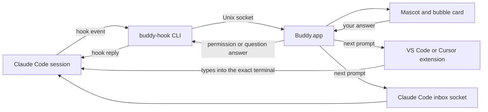

<p align="center">
  
</p>

<h1 align="center">Buddy</h1>

<p align="center">
  A tiny pixel mascot on your desktop for every Claude Code session.<br>
  It tells you when a session needs you, and lets you answer from the mascot.
</p>

<p align="center">
  
  
  
  
</p>

## Why I built this

I run about four Claude Code sessions at once, across different projects. I kept missing the one that was waiting for a permission or an answer. It sat there for ten minutes while I looked at something else.

Then I saw another dev with a little mascot that stayed on screen all day. It reminded me of Clippy. I thought: what if every session had one, and the mascot could ask me things the way Clippy did?

So Buddy is a small, friendly Clippy for Claude Code. It is a personal tool. I use it every day. I put it here in case you want it too.

## What it does

Buddy is a native macOS app (Swift 6, SwiftUI and AppKit). It puts one mascot on your desktop for each running Claude Code session. It works with:

- any terminal
- the terminals in VS Code and Cursor
- local Code sessions in Claude Desktop

Each mascot shows what its session is doing:

| State | What you see |
| --- | --- |
| Working | A laptop with scrolling code |
| Question | A "?" bubble and a little hop |
| Permission | A worried face and a yellow shield |
| Done | A big grin, confetti and a green check |
| Error | Dizzy eyes and a small fire |
| Sleeping | Zzz, when nothing runs |
| Session ended | A wave goodbye, then it walks off |

Idle mascots wander along the bottom of your screen. You can drag one and it stays where you drop it.

Every session gets its own look. Buddy hashes the project path, so the same project always gets the same mascot. There are 10 palettes and 16 outfits. You can re-roll the look or pick one from the right-click menu. A name tag under each mascot shows the project.

<p align="center">
  
</p>

### The cards

Click a mascot and a bubble card opens. There are three kinds.

- **Permission card.** It shows the full tool input. It warns you when the sandbox is off. It makes hidden Unicode visible. Buttons: Allow, Deny (with an optional reason), Always allow (only the options Claude itself suggests), and Answer in terminal.
- **Question card.** It shows the options from Claude's question. Single choice uses radio buttons. Multiple choice uses checkboxes. There is an Other field for free text.
- **Done card.** It shows Claude's last message and a "Next prompt" box. Send types the prompt into the session. Jump takes you to the right place.

Jump focuses the right terminal tab or editor window. For Claude Desktop, Jump brings the app to the front. Claude Desktop has no per-session link, so that is as close as it gets.

## How it works



Claude Code runs a small CLI, `buddy-hook`, for each hook event. The CLI sends the event to Buddy over a Unix socket. Buddy shows a card. When you answer a permission or a question, the answer goes back through the hook.

The terminal prompt stays live the whole time. The first answer wins, whether you give it in the terminal or on the card.

The next prompt takes one of two routes. The companion VS Code and Cursor extension types it into the exact terminal, so it is real user input. Or Buddy writes to Claude Code's local inbox socket. Claude Desktop uses only the inbox.

More detail in [docs/ARCHITECTURE.md](docs/ARCHITECTURE.md).

## Install

You need macOS 14 or later.

**From a release (easiest).** Download `Buddy-<version>.dmg` from the [Releases](https://github.com/forbee-dev/buddy/releases) page. Drag Buddy to Applications.

Buddy is not notarized yet. The first time you open it, macOS will block it. Go to System Settings, then Privacy & Security, and click **Open Anyway**.

**From source.**

```sh
git clone https://github.com/forbee-dev/buddy.git
cd buddy
./scripts/build-app.sh   # builds build/Buddy.app
./scripts/make-dmg.sh    # optional: builds build/Buddy-<version>.dmg
```

On first launch, Buddy walks you through setup:

1. Permissions
2. Move to Applications
3. Install hooks
4. Install the VS Code / Cursor extension (the `.vsix` is bundled)
5. Start at login

Install hooks adds Buddy's hooks to `~/.claude/settings.json`. It makes a backup first. One click removes them again.

Full steps and troubleshooting: [docs/INSTALL.md](docs/INSTALL.md).

## Using it

- **Menu bar.** The icon is an outline. It fills with a count dot when a session needs you, even while the buddies are hidden. The dropdown has Hide/Show buddies, a list of buddies (the ones that need you come first, each with thumbnail, project, state dot and app name), Settings, Welcome and Quit.
- **Pinning.** Drag a mascot to pin it. Double-click to unpin.
- **Right-click menu.** Re-roll look, palette, outfit, Move to left/right edge, Jump and Hide.
- **Modes.** One mascot per session (the default), or a single buddy with a badge and a session picker.
- **Size.** Tiny 1x, Small 1.5x, Medium 2x (default), Large 3x, Huge 4x. Settings has a live preview.
- **Settings tabs.** General, Size, Notifications, Hooks & Extension, Permissions, About. Notifications are set per event type.

| Shortcut | Action |
| --- | --- |
| `⌘↩` | Allow / Submit |
| `⌘⌫` | Deny |
| `⌘T` | Answer in terminal / Claude Desktop |
| `Esc` | Close the bubble |
| `⌘B` | Hide / Show buddies |
| `⌘,` | Settings |
| `⌘Q` | Quit |
| `⌃⌥B` | Global: open the newest waiting card |

The global shortcut is configurable: Off, `⌃⌥B`, `⌃⌥Space` or `⌃⌥⌘B`.

Accessibility: Buddy respects Reduce Motion (no walking, still frames) and Reduce Transparency. It posts VoiceOver announcements. Its panels are hidden from screenshots and screen sharing.

When no sessions run, Buddy uses about 0% CPU. The hook adds about 65 ms per event.

## What it can't do (yet)

- **Cloud and VM sessions.** Claude Code cloud sessions and plain Claude Desktop chats can't be tracked. No hooks reach your Mac from them.
- **Notarization.** The app is not notarized yet. That is why you need Open Anyway on first launch.
- **The inbox socket.** It is an internal Claude Code mechanism. It could change in a future version and break the next-prompt route for Claude Desktop.
- **Peer messages.** A next prompt sent through the inbox reaches Claude as a peer message, not as something you typed.

## Security and privacy

- Buddy never approves anything for you. Every click is yours.
- Clicks are bound to the exact request on the card. Buttons are disarmed for a moment when a card changes, so a late click can't hit the wrong request.
- It fails open. If Buddy is not running, Claude Code behaves as if Buddy was never there.
- Nothing leaves your Mac. No network, no telemetry. Prompts, commands and tokens are not logged.
- Hooks go into `~/.claude/settings.json` with a backup, and one click removes them.

More in [docs/SECURITY.md](docs/SECURITY.md).

## Make your own buddy

The sprites are plain JSON. `design/sprites.json` holds 32x32 character grids, palettes, outfit layers and an effects layer. `design/gen-sprites.js` generates it.

Open `design/preview.html` in a browser to see every state and every outfit. To add an outfit, add a layer to the generator, run it, and check the preview. Outfit contributions are very welcome.

`docs/assets/make-hero.js` renders the GIF and the outfit grid above from the same data. It needs Node and `ffmpeg`.

## Project layout

```
Sources/BuddyCore    logic you can unit test
Sources/BuddyApp     the macOS app
Sources/buddy-hook   the CLI that each hook runs
Tests/               tests
vscode-ext/          companion extension for VS Code and Cursor (TypeScript)
design/              sprites, generator, preview
scripts/             build and DMG scripts
docs/                install, releasing, security, architecture, protocol notes
```

## Contributing

Issues and pull requests are welcome. Small ones are best. For a big change, open an issue first so we can talk about it.

Before you send a PR, build with `./scripts/build-app.sh` and run the tests. Details are in [docs/INSTALL.md](docs/INSTALL.md). Release steps are in [docs/RELEASING.md](docs/RELEASING.md).

I built Buddy with Claude Code itself. Different agents did the hooks research, the sprite design, the Swift app, the extension and the security review. I read and tested the result. Bugs are still possible.

## Credits and disclaimer

Buddy is an unofficial fan project. It is not affiliated with, endorsed by, or sponsored by Anthropic. Claude and Claude Code are trademarks of Anthropic, PBC. The mascot is a fan-made pixel tribute.

## License

[MIT](LICENSE) © 2026 Tiago Santos
