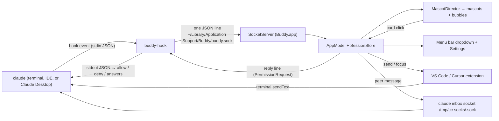

# Architecture



## Components

| Part | Where | Role |
|---|---|---|
| `buddy-hook` | `Sources/buddy-hook` | Claude Code runs it for each hook event. It connects, checks the app, sends one line, and for `PermissionRequest` waits for one reply line. It fails open. |
| `BuddyCore` | `Sources/BuddyCore` | Logic with no AppKit: wire protocol, session store (state machine), hook installer, peer checks, prompt guard, sprite renderer, look picker, size math. Fully tested. |
| `Buddy.app` | `Sources/BuddyApp` | Socket server, mascots (`NSPanel` per mascot), SwiftUI bubbles, menu bar, Settings, notifications, Jump. |
| Extension | `vscode-ext/` | Connects to the same socket. Reports its terminals and types a next prompt on request. |

## Routes back to Claude

1. **PermissionRequest reply**: the hook waits; the card's answer goes back on the same connection; the hook prints it as hook JSON. This covers Allow, Deny, Always allow, and `AskUserQuestion` answers (`updatedInput.answers`). "Answer in terminal" replies `null`, and the terminal dialog stays in charge. The first answer wins.
2. **Extension**: `send` to the terminal whose shell pid matches the session. The text arrives as user input.
3. **Inbox socket**: Claude Code's per-session socket. The text arrives as a peer message. This is the only route for Claude Desktop sessions.

## Session states

`starting → working → needsPermission / asking → working → done → idle`, plus `error` (a tool failed) and `ended` (SessionEnd or the process is gone; the reaper checks every 5 s while sessions exist). See `SessionStore.transition`.

## Sprite pipeline

```
design/sprites.json  (32×32 char grids, legend → palette keys, bases.<name>.states, outfits, palettes)
   → SpriteSheet.load          (sorted names, dynamic legend and palettes)
   → LookPicker.pick(cwd)      (FNV-1a of the project path → base, palette, outfit; user overrides per cwd)
   → sheet.anim(chain)         (state fallback, e.g. permission → question → idle)
   → AnimClock.frameIndex      (fps, loop or once, never out of range)
   → SpriteRenderer.render     (body rows, outfit shifted by frame head, frame fx on top, optional mirror)
   → CGImage, nearest-neighbor (points per sprite pixel from BuddySize; whole device pixels on Retina)
```

The same renderer makes the menu thumbnails, the Settings preview, and the menu bar template icon (silhouette). `scripts/make-icon.swift` makes the app icon from the same JSON at build time.

## Timers

- Animation: one timer for all mascots. It exists only while mascots exist: 8 Hz at rest, 30 Hz while one moves. It pauses when the screens sleep, the user session is inactive, or the buddies are hidden.
- Reaper: every 5 s while sessions exist.
