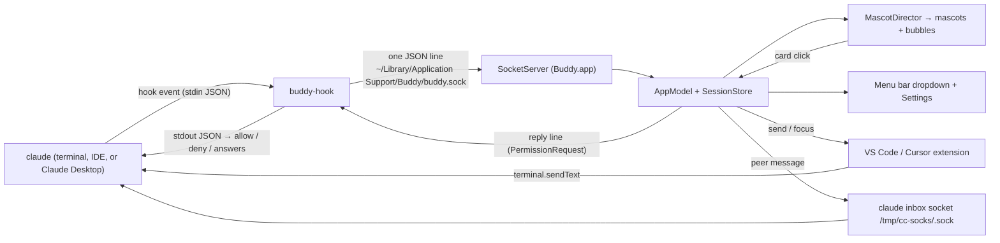

# Architecture



## Components

| Part | Where | Role |
|---|---|---|
| `buddy-hook` | `Sources/buddy-hook` | Claude Code runs it for each hook event. It connects, checks the app, sends one line, and for `PermissionRequest` waits for one reply line. It fails open. |
| `BuddyCore` | `Sources/BuddyCore` | Logic with no AppKit: wire protocol, session store (state machine), hook installer, peer checks, prompt guard, sprite renderer, look picker, size math. Unit-tested. |
| `Buddy.app` | `Sources/BuddyApp` | Socket server, mascots (`NSPanel` per mascot), SwiftUI bubbles, menu bar, Settings, notifications, Jump. |
| Extension | `vscode-ext/` | Connects to the same socket. Reports its terminals and types a next prompt on request. |
| Remote hook | `scripts/remote/` | Opt-in SSH sessions: `buddy-hook-remote` runs on the remote host and sends events over an `ssh -R` forward to `remote.sock`. `RemoteAuth`, `RemoteJump`, `RemoteInstall` (Core) check and localize them. See SSH.md. |

## Routes back to Claude

1. **PermissionRequest reply**: the hook waits; the card's answer goes back on the same connection; the hook prints it as hook JSON. This covers Allow, Deny, Always allow, and `AskUserQuestion` answers (`updatedInput.answers`). "Answer in terminal" replies `null`, and the terminal dialog stays in charge. The first answer wins.
2. **Extension**: `send` to the terminal whose shell pid matches the session. The text arrives as user input.
3. **Inbox socket**: Claude Code's per-session socket. The text arrives as a peer message. This is the only route for Claude Desktop sessions.

## Session states

`starting → working → needsPermission / asking → working → done → idle`, plus `error` (a tool failed) and `ended` (SessionEnd or the process is gone; the reaper checks every 5 s while sessions exist). See `SessionStore.transition`.

Subagents: `running`, `needsPermission`, `asking`, `done`, `failed`, `stopped` (killed with TaskStop). Shells: `running`, `finished`, `stopped`. Rules: `Activity.swift` and docs/protocol.md.

## Extras

| Part | Where | Runs |
|---|---|---|
| Impatience | `Impatience` (Core), `MascotController.stepImpatience` | On the animation tick; the "still waiting" reminder on the reaper tick |
| Away digest | `AwayDigest` (Core), `AwayWatch` | Screen sleep and wake, session switch, and system idle checked on the reaper tick |
| High-five, party, tips | `HighFive`, `Tips`, `TipLimiter` (Core), `MascotDirector.celebrate` | On state changes; tips on hook events |
| Sounds | `SoundGate`, `SoundRules` (Core), `Sounds` (app) | On state changes. One sound per 1.5 s; a held sound is queued with `Task.sleep` |
| Hidden Bee | `BeeEgg` (Core), `BeeFlight`, `MascotDirector.beeFound` | Once, on unlock. The flight uses the animation tick. See SKINS.md "Hidden extras" |
| Skins | `SkinLoader`, `SpriteSheet.merged` (Core), `SkinStore` | At start and on a change in the skins folder (a directory event source) |
| Tokens and cost | `UsageMeter`, `PriceTable` (Core), `UsageWorker` actor | On hook events, at most every 5 s per working session, plus Stop; off the main thread |
| Name tags | `TagLayout` (Core), `MascotController.layoutTag`, `MascotDirector.tick` | Free mode: spawn, walk, and crowd checks use the wider of sprite and tag; tags that still overlap are cut (tooltip) or stacked, on the animation tick |

## Sprite pipeline

```
design/sprites.json  (32×32 char grids, legend → palette keys, bases.<name>.states, outfits, palettes)
   → SpriteSheet.load          (sorted names, dynamic legend and palettes)
   → merged(skins)             (enabled skins under `<skin>/<name>`: palettes, outfits, characters, fixed colors)
   → LookPicker.pick(cwd)      (FNV-1a of the project path → character, palette, outfit; user overrides per cwd)
   → sheet.anim(chain)         (state fallback, e.g. permission → question → idle)
   → AnimClock.frameIndex      (fps, loop or once, never out of range)
   → SpriteRenderer.render     (body rows, outfit shifted by frame head, frame fx on top, optional mirror)
   → CGImage, nearest-neighbor (points per sprite pixel from BuddySize; whole device pixels on Retina)
```

The same renderer makes the menu thumbnails, the Settings preview, and the menu bar template icon (silhouette). `scripts/make-icon.swift` makes the app icon from the same JSON at build time.

## Timers

- Animation: one timer for all mascots. It exists only while mascots exist: 8 Hz at rest, 30 Hz while one moves. It pauses when the screens sleep, the user session is inactive, or the buddies are hidden.
- Idle and done loops are parked as Core Animation animations (in progress).
- Reaper: every 5 s while sessions exist. It also sends the one "still waiting" reminder and checks system idle for the away digest.
- No other repeating timer. One-shot waits use `Task.sleep`. Impatience hops, the tip (20 s), and the digest (60 s) run on the animation tick. The skins folder uses a directory event source.
